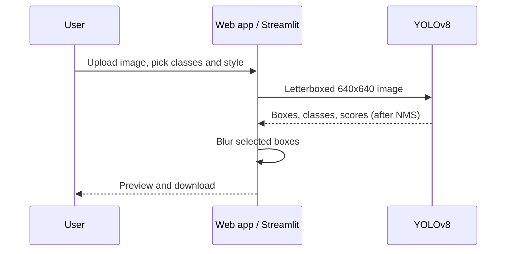

# BlurAnything

Blur people, cars, screens and 77 other kinds of objects in a photo, in one click.
BlurAnything detects objects with [YOLOv8](https://docs.ultralytics.com/models/yolov8/) and anonymises them with a gaussian blur, pixelation or a black box.

It comes in three flavours that share the same pipeline:

| | What | Where the AI runs |
|---|---|---|
| **Web app** (`web/`) | Static site, deployed on Netlify | In the browser (ONNX Runtime Web). Images never leave the device. |
| **API** (`backend/`) | FastAPI service with `/detect` and `/blur` | On the server (PyTorch) |
| **Streamlit app** (`frontend/`) | Local UI for the API, or standalone | In-process, or through the API |

## Features

- Detection of the 80 [COCO](https://cocodataset.org/) classes, with a fast (YOLOv8n) or accurate (YOLOv8x) model.
- Auto-blur by class ("blur every person") plus object-by-object selection.
- Three styles: gaussian blur, pixelate, black box. Adjustable intensity, margin and confidence threshold.
- Web app only: draw any area by hand, paste images from the clipboard, FR/EN, dark/light theme.
- Download of the anonymised image.

## Project structure

```text
BlurAnything/
├── backend/
│   ├── app.py              # FastAPI application (/health, /classes, /detect, /blur)
│   ├── blur.py             # Pillow blur / pixelate / mask, shared with the Streamlit app
│   └── detect.py           # YOLOv8 loading (cached) and detection
├── frontend/
│   └── streamlit_app.py    # Streamlit UI
├── web/                    # In-browser version (Netlify)
│   ├── index.html, app.js, style.css
│   ├── yolo.js             # YOLOv8 pre/post-processing (letterbox, decode, NMS)
│   ├── models/yolov8n.onnx # Exported YOLOv8n weights
│   └── tests/              # Node unit tests
├── tests/                  # Pytest suite
├── Dockerfile, docker-compose.yml
└── netlify.toml
```

## Web app

```bash
cd web
npm install
npm run serve        # copies ONNX Runtime into web/vendor/ and serves on http://localhost:8080
npm test
```

Netlify builds it with `netlify.toml` (base `web/`, command `npm run build`, publish `.`).
The COOP/COEP headers enable multi-threaded WebAssembly where the browser supports it.

To re-export the model after changing weights:

```bash
yolo export model=models/yolov8n.pt format=onnx imgsz=640 opset=12 simplify=True
cp models/yolov8n.onnx web/models/
```

## API and Streamlit app

### With Docker

```bash
docker compose up --build
```

API on <http://localhost:8000> (docs at `/docs`), Streamlit on <http://localhost:8501>.

### Locally

```bash
python -m venv venv
source venv/bin/activate            # Windows: venv\Scripts\activate
pip install --index-url https://download.pytorch.org/whl/cpu torch torchvision   # optional, CPU-only torch
pip install -r requirements-dev.txt

uvicorn backend.app:app --reload               # API
streamlit run frontend/streamlit_app.py        # UI, runs detection in-process
BLURANYTHING_API_URL=http://localhost:8000 streamlit run frontend/streamlit_app.py   # UI through the API
```

On Windows, `.\run.ps1` starts both. Weights are downloaded to `models/` on first use.

### Endpoints

| Method | Path | Description |
|---|---|---|
| GET | `/health` | Liveness probe |
| GET | `/classes` | Classes the model can detect |
| POST | `/detect` | Form fields `file`, `type_model` (`fast`/`accurate`), `confidence`, `classes` (comma separated). Returns JSON detections. |
| POST | `/blur` | Same fields plus `method` (`gaussian`/`pixelate`/`solid`), `strength`, `padding`, and optional `boxes` (JSON list) to blur exact regions. Returns the image; `X-Detections` holds the number of blurred regions. |

```bash
curl -F file=@photo.jpg -F classes=person,car -F method=pixelate \
     http://localhost:8000/blur -o blurred.jpg
```

Errors are returned as `{"error": "..."}` with a 400 (bad input) or 413 (file too large) status.

### Configuration

| Variable | Default | Used by |
|---|---|---|
| `BLURANYTHING_MODELS_DIR` | `models` | API, Streamlit |
| `BLURANYTHING_DEFAULT_MODEL` | `fast` | API, Streamlit |
| `BLURANYTHING_MAX_UPLOAD_MB` | `15` | API |
| `BLURANYTHING_CORS_ORIGINS` | `http://localhost:8501` | API |
| `BLURANYTHING_API_URL` | empty (in-process) | Streamlit |

## Tests

```bash
pytest -q             # unit tests, the model is mocked
pytest -q -m slow     # end to end with the real YOLOv8n weights
cd web && npm test    # web pre/post-processing
```

## How it works



## Licence

BlurAnything is released under the [GNU AGPL-3.0](LICENSE), the same licence as the Ultralytics YOLOv8 library and weights it uses.
The sample photo (`web/samples/street.jpg`) comes from the Ultralytics repository.
